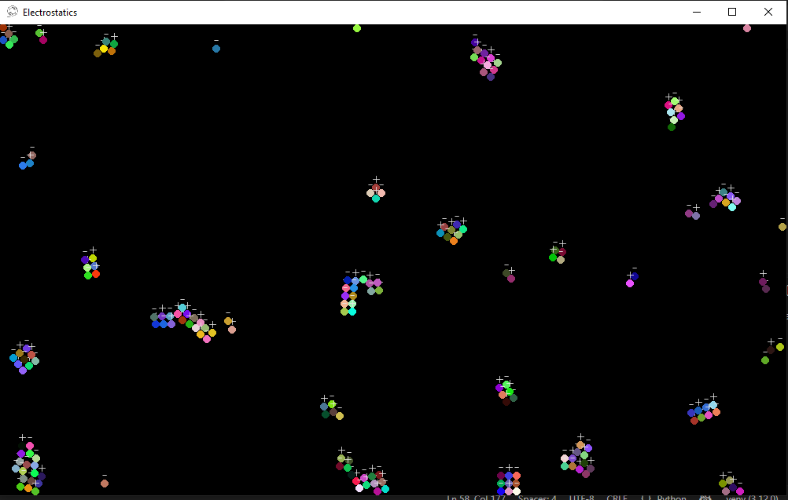
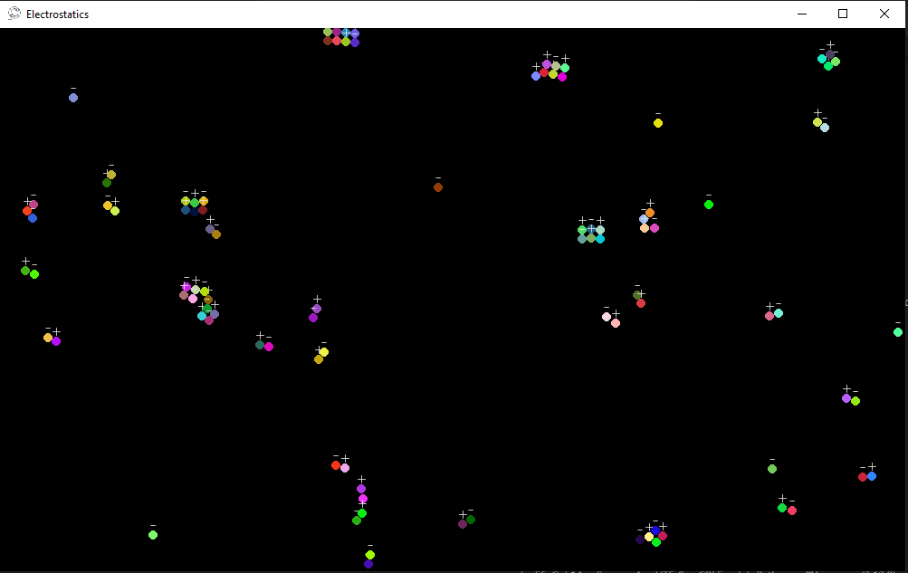

# Electrostatics Simulation

A real-time **electrostatics simulation built with Python and Pygame**, created as a hands-on project for learning physics, vectors, forces, acceleration, and particle interaction.

The simulation contains multiple charged particles that interact through **Coulomb's law**, move according to the resulting forces, collide with the boundaries, and interact physically with one another.

The main goal of this project is not to create a perfectly physically accurate scientific simulator, but to understand how physical laws can be translated into a working simulation.

---

## Preview

<table>
  <tr>
    <td align="center">
      
    </td>
    <td align="center">
      
    </td>
  </tr>
</table>

---

## Features

* Real-time simulation of multiple charged particles
* Positive and negative electric charges
* Coulomb force calculation
* Attraction between opposite charges
* Repulsion between equal-sign charges
* Multiple-particle force interaction
* Vector-based force direction
* Particle velocity and acceleration
* Wall collision and bounce
* Particle-to-particle collision detection
* Positional collision correction
* Collision impulse response
* Friction
* Configurable damping
* Resizable Pygame window
* Simple keyboard-controlled external force
* Randomized particle positions, colors, and charges

---

## Physics

### Coulomb's Law

The electric force between two point charges is calculated using:

$$
F = k\frac{|q_1q_2|}{r^2}
$$

where:

* `F` is the magnitude of the electrostatic force
* `q1` and `q2` are the charges
* `r` is the distance between the charges
* `k` is Coulomb's constant

The simulation uses:

```text
k = 9 × 10⁹
```

The sign of the charges determines the direction of the interaction:

```text
Positive + Positive  → Repulsion
Negative + Negative  → Repulsion
Positive + Negative  → Attraction
```

For each particle, the force is converted into acceleration:

$$
a = \frac{F}{m}
$$

The acceleration is then used to update the particle's velocity.

Because the simulation runs frame-by-frame, the calculated acceleration is scaled according to the simulation's frame rate.

---

## How the Force Direction Works

For every pair of particles, the simulation calculates the displacement between them:

```text
dx = x₁ - x₂
dy = y₁ - y₂
```

The distance is obtained from those components:

$$
r = \sqrt{dx^2 + dy^2}
$$

The displacement vector is normalized to obtain a direction:

$$
\hat{r} =
\left(
\frac{dx}{r},
\frac{dy}{r}
\right)
$$

The calculated force magnitude is then applied along this direction.

This allows particles to interact correctly in two dimensions rather than only along the X or Y axis.

---

## Simulation Architecture

The project uses a small inheritance-based structure:

```text
Entity
   │
   └── Physic
         │
         └── Ball
               │
               └── Electron
```

### `Entity`

The base object containing common properties such as:

* Position
* Color

### `Physic`

Adds basic physics behavior:

* Velocity
* Mass
* Gravity
* Forces
* Friction
* Wall collision interface
* Particle collision interface

### `Ball`

Adds circular geometry and collision behavior:

* Radius
* Drawing
* Wall collision
* Other-ball collision
* Positional correction
* Collision impulse

### `Electron`

Extends `Ball` with electrical properties:

* Charge
* Charge sign
* Coulomb-force calculation
* Charge visualization

---

## Particle Interaction

Each particle checks every other particle and calculates the electrical force between them.

For `N` particles, the current implementation performs pairwise interaction checks, giving approximately:

$$
O(N^2)
$$

interaction checks per simulation step.

For example, with 100 particles, each particle evaluates its interaction with the other particles.

This approach is simple and useful for learning, although much larger simulations would eventually require more advanced optimization techniques.

---

## Collisions

Electrostatic interaction and physical collision are treated separately.

### Wall collisions

When a particle reaches the boundary of the window:

1. Its position is corrected so it does not remain outside the screen.
2. Its velocity along the collision axis is reversed.
3. A damping factor is applied.
4. Friction can then reduce tangential velocity.

### Particle collisions

When two particles overlap:

1. Their positions are corrected.
2. The relative velocity along the collision normal is calculated.
3. An impulse is applied.
4. The particles move apart according to the collision response.

The current collision response assumes equal masses for the impulse calculation.

---

## Project Structure

A simple version of the project is organized like this:

```text
Electrostatics/
│
├── assets/
│   └── icon.png
│
├── Base.py
├── main.py
├── README.md
└── requirements.txt
```

### Example `requirements.txt`

```text
pygame
```

---

## Installation

Clone the repository:

```bash
git clone https://github.com/MainSoheil/Electrostatics.git
cd Electrostatics
```

Create a virtual environment:

### Windows

```bash
python -m venv .venv
.venv\Scripts\activate
```

### Linux / macOS

```bash
python3 -m venv .venv
source .venv/bin/activate
```

Install the dependency:

```bash
pip install -r requirements.txt
```

Then run the simulation:

```bash
python main.py
```

---

## Controls

### Arrow Keys

The arrow keys apply an external force to all particles:

```text
↑   Apply force upward
↓   Apply force downward
←   Apply force left
→   Apply force right
```

### Mouse

Use the mouse to add new charged particles:

```text
Left Click   →   Add a positive electron (+)
Right Click  →   Add a negative electron (-)
```

The new electron is created at the mouse cursor's position.

### Space

Press:

```text
SPACE
```

to randomly delete one electron from the simulation.

### Escape

Press:

```text
ESC
```

to close the simulation.

---

## Configuration

Particle behavior can be modified directly in the source code.

For example:

```python
Electron(
    pos,
    radius,
    charge,
)
```

The simulation currently creates particles with randomly selected positive or negative charges.

Example:

```python
choice([-1, 1]) * 50 * 10**-6
```

This produces charges of:

```text
+50 μC
-50 μC
```

---

## Important Note About Units

This project uses real physical concepts and equations, but it is **not a strict SI-accurate physical simulator**.

The simulation uses Pygame pixels for position while Coulomb's law is normally defined using meters. In addition, the selected particle masses, charges, timestep, and other parameters are chosen to make the system visually interesting and computationally manageable.

Therefore, the values should primarily be interpreted as **simulation parameters** rather than a perfectly scaled real-world physical system.

This is intentional: the project is primarily an educational experiment for understanding the relationship between:

```text
Force
  ↓
Acceleration
  ↓
Velocity
  ↓
Position
```

---

## What I Learned From This Project

This project was built to explore how mathematical physics can become executable code.

Some of the main concepts explored are:

* Coulomb's law
* Electric attraction and repulsion
* Vectors
* Vector normalization
* Distance between points
* Newton's laws of motion
* Force → acceleration
* Velocity integration
* Collision detection
* Collision response
* Friction
* Damping
* Frame-based simulation
* Many-body interaction

One of the most interesting parts is that a relatively small mathematical rule can produce complicated behavior when many particles interact simultaneously.

---

## Future Improvements

Possible future experiments include:

* Replace the current timestep handling with a proper `dt`-based physics loop
* Implement more physically consistent SI-to-screen scaling
* Use pairwise force calculation only once per particle pair
* Add adjustable charge and mass values
* Add charge sliders and simulation controls
* Display force vectors
* Display velocity vectors
* Display acceleration vectors
* Add an electric-field visualization
* Add fixed charges
* Add electric field lines
* Add an energy calculation
* Add potential energy
* Add conservation-of-energy experiments
* Improve collision response for different masses
* Add spatial partitioning for larger particle counts
* Experiment with hundreds or thousands of particles

---

## Purpose

This project is part of my process of learning physics through programming.

Instead of only studying equations theoretically, I am trying to understand them by implementing the underlying ideas and observing their behavior visually.

The project therefore acts as both:

**a physics experiment**

and

**a programming experiment.**

---

## Technologies

* **Python**
* **Pygame**

---

## License

This project is intended primarily for learning and experimentation.

Feel free to explore the code, experiment with the physics, and modify the simulation for your own educational purposes.
